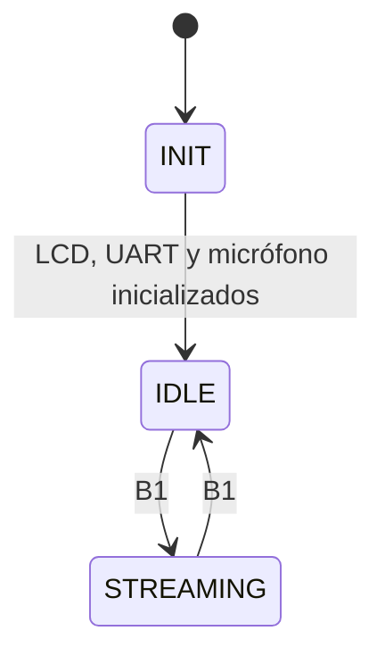

# Cómo funciona

Explicación del código de este repo: qué hace cada parte, por qué está hecha así y en qué orden conviene leerla.

## 1. La idea general

El sistema captura el audio del micrófono y lo manda a la PC, que lo guarda como `.wav`. El pulsador B1 arranca y corta la grabación, y el LCD muestra el estado.

```
 INMP441 ──I2S──► I2S2 ──DMA──► i2sBuf ──► API_mic ──► app.c (MEF) ──► API_uart ──USART2──► ST-Link ──USB──► PC
 (micrófono)                    (doble                                                                  (record_wav.py)
                                 buffer)              app.c ──► API_lcd ──I2C1──► PCF8574 ──► LCD 1602
                                                      B1 ──► API_debounce ──► app.c
```

1. El **micrófono** manda muestras digitales por I2S, sin parar, 16 000 por segundo.
2. El **DMA** las copia solo, sin usar la CPU, a un buffer `i2sBuf` dividido en dos mitades.
3. Cada vez que el DMA llena una mitad (cada **32 ms**), una **interrupción** avisa que hay un bloque listo.
4. La **MEF** (`app.c`) pide ese bloque a `API_mic`, que lo convierte a 16 bits, y lo manda por la **UART** con `API_uart`.
5. El **ST-Link** de la Nucleo convierte esa UART en un puerto serie virtual por USB, y `tools/record_wav.py` arma el `.wav` en la PC.
6. En paralelo, la MEF lee **B1** (con el antirrebote de la práctica 4) y escribe en el **LCD** por I2C.

Hay **dos "hilos" de ejecución**:

| Quién | Cuándo corre | Qué hace | Puede bloquearse? |
|---|---|---|---|
| **Interrupción del DMA** (`HAL_I2S_Rx...Callback`) | Cada 32 ms, interrumpe al lazo principal | Anota qué mitad del buffer está lista | **No**. Hace una sola asignación |
| **Lazo principal** (`while (1)` → `appFSM_update()`) | Todo el resto del tiempo | Lee B1, manda audio, escribe en el LCD | **Sí**, pero poco: mandar un bloque tarda ~20 ms y escribir una línea del LCD ~14 ms |

## 2. Qué archivo es de quién

CubeMX genera código y lo regenera cada vez que tocás el `.ioc`. Solo respeta lo que está **entre** los comentarios `/* USER CODE BEGIN xxx */` y `/* USER CODE END xxx */`.

| Archivo | Origen | Qué tiene |
|---|---|---|
| `Core/Src/main.c` | CubeMX + `appFSM_init()` y `appFSM_update()` en bloques USER CODE | Inicializa GPIO, DMA, I2S2, USART2 e I2C1 y llama a la MEF |
| `Core/Src/app.c` | Propio | La MEF de la aplicación |
| `Drivers/API/Src/API_mic.c` | Propio | Driver del micrófono: bloque listo, conversión a 16 bits |
| `Drivers/API/Src/API_mic_port.c` | Propio | Port del micrófono: arranca el DMA del I2S2 y recibe los callbacks de la HAL |
| `Drivers/API/Src/API_lcd.c` | Driver de la cátedra (Ing. Pavelek), modificado | Driver del LCD 1602: inicialización en 4 bits, texto, cursor |
| `Drivers/API/Src/API_lcd_port.c` | Driver de la cátedra, modificado | Port del LCD: un byte al PCF8574 por I2C1, y la demora |
| `Drivers/API/Src/API_uart.c` | Práctica 5, modificado | Envío por USART2 a 500 000 baud |
| `Drivers/API/Src/API_debounce.c` | Práctica 4, sin cambios | MEF antirrebote de B1 |
| `Drivers/API/Src/API_delay.c` | Práctica 3, sin cambios | Retardos no bloqueantes |
| `Core/Src/stm32f4xx_hal_msp.c` | CubeMX | Configura los pines de I2S2, I2C1 y USART2 |
| `tools/record_wav.py` | Propio | Graba el `.wav` en la PC |

## 3. La MEF (`app.c`)

`main()` inicializa los periféricos (código de CubeMX), llama a `appFSM_init()` y después solo hace:

```c
while (1) {
  appFSM_update();
}
```

`appFSM_update()` ejecuta un paso de la MEF y vuelve. No hay `HAL_Delay()` en el lazo: el contador de segundos del LCD usa `API_delay`, que mira el reloj sin detenerse.



| Estado | LCD | Qué hace | Sale a |
|---|---|---|---|
| `APP_INIT` (punto de entrada) | `Seismotor` / `B1 para grabar` | Inicializa el LCD, la UART y el micrófono. Si la UART o el micrófono fallan, va a `Error_Handler()` | `IDLE`, en la misma llamada |
| `APP_IDLE` | `Seismotor` / `B1 para grabar` | Espera B1. El micrófono sigue capturando, pero nadie lee los bloques | `STREAMING` con B1 |
| `APP_STREAMING` | `Grabando` / `12 s` | Manda cada bloque por la UART y suma un segundo al contador del LCD con `API_delay` | `IDLE` con B1 |

Detalles:

- **Las acciones van en la transición, no en el estado.** El LCD se escribe una vez, al cambiar de estado, y no en cada vuelta del lazo, porque escribir una línea tarda ~14 ms.
- **En IDLE no se leen los bloques.** El micrófono captura siempre, pero no se acumula audio viejo: hay solo dos mitades y el DMA las va pisando. Al apretar B1, el primer bloque que se manda es la última mitad completa, de hace como mucho 32 ms.
- **`readKey()` se lee en todos los estados**, al principio de `appFSM_update()`. Así una pulsación se usa una sola vez.
- **`debounceFSM_update()` va al final** de `appFSM_update()`: la MEF antirrebote avanza en cada vuelta del lazo, igual que en la práctica 4.

## 4. El micrófono (`API_mic` + `API_mic_port`)

### El formato de lo que llega

El I2S está configurado a 16 kHz con **32 bits por canal** y dos canales. El INMP441 tiene `L/R` a GND, así que habla solo en el canal **izquierdo**; el derecho llega vacío.

Cada "frame" (una muestra de cada canal) son 64 bits. El DMA trabaja de a 16 bits (*half-words*), así que un frame ocupa **4 posiciones** de `i2sBuf`:

```
 i2sBuf:   [ L alto | L bajo | R alto | R bajo ] [ L alto | L bajo | R alto | R bajo ] ...
             frame[0]  frame[1] frame[2] frame[3]
```

`sampleLeft()` junta `frame[0]` y `frame[1]` en un entero de 32 bits. El micrófono manda **24 bits** útiles alineados a la izquierda, así que se hace `>> 8` para quedarse con un número con signo de 24 bits.

### El doble buffer

`i2sBuf` tiene lugar para 2 × 512 frames. El DMA está en modo **circular**: llena la primera mitad, después la segunda, y vuelve a empezar. Al terminar cada mitad la HAL llama a un callback:

- `HAL_I2S_RxHalfCpltCallback`: terminó la **primera** mitad.
- `HAL_I2S_RxCpltCallback`: terminó la **segunda** mitad.

512 frames / 16 000 por segundo = **32 ms**. Mientras el DMA llena una mitad, la aplicación tiene 32 ms para leer la otra antes de que se pise.

### Driver y port

- **`API_mic_port.c`** es lo único que conoce el hardware: arranca el DMA con `HAL_I2S_Receive_DMA` sobre `hi2s2` y tiene los dos callbacks de la HAL.
- **`API_mic.c`** no incluye la HAL. Le pasa a `micPortStart()` un **puntero a función** (`onHalfReady`), y el port la llama desde los callbacks con el número de mitad. Así la interrupción no ata el driver al hardware.
- `onHalfReady()` solo anota la mitad en `readyHalf`. Si ya había una sin leer, la cuenta en `dropped` (`micDropped()`).
- `micGetBlock()` corre en el lazo, no en la interrupción. Convierte la mitad lista a 16 bits y borra `readyHalf`.

### Conversión a 16 bits

1. `sampleLeft()` da el valor de 24 bits.
2. `>> PCM_SHIFT` (6) lo achica. Con `>> 8` los 24 bits entrarían justo en 16 (escala completa). Con `>> 6` se desplazan 2 bits menos, o sea **4× de ganancia**: el micrófono casi nunca llega a su máximo, así que se amplifica.
3. Si con esa ganancia se pasa de ±32767, se **recorta** (satura) en vez de dar la vuelta.

## 5. El envío a la PC (`API_uart` + `record_wav.py`)

### Por qué 500 000 baud

El audio son 16 000 muestras/s × 2 bytes = **32 KB/s**. Una UART 8N1 manda 10 bits por byte, así que hacen falta al menos 320 000 baud. Se usa **500 000** porque con el reloj de 16 MHz da exacto (16 MHz / 16 / 2) y deja margen: 50 KB/s.

Mandar un bloque (1027 bytes) tarda 1027 × 10 / 500 000 = **20.5 ms**, de los 32 ms que hay hasta el siguiente.

### El formato del bloque

```
 A5 5A seq  |  512 muestras int16 little-endian (1024 bytes)
```

- **`A5 5A`** marca el principio de cada bloque. Como el audio puede contener esos bytes por casualidad, la PC solo acepta una cabecera si la siguiente aparece exactamente 1027 bytes después.
- **`seq`** es un contador de 0 a 255 que sube en cada bloque. Si en la PC salta (por ejemplo, de 10 a 12), se perdió un bloque.

### Cambios a `API_uart` respecto de la práctica 5

- 500 000 baud en vez de 9600.
- Envíos de hasta 1100 bytes en vez de 256, para que entre un bloque.
- Sin el mensaje de bienvenida al iniciar, porque se mezclaría con el audio.

### `record_wav.py`

- Sin argumentos espera a que llegue audio (B1) y corta cuando deja de llegar durante 1 s (el segundo B1). Con un número graba esa cantidad de segundos. El nombre del archivo es opcional.
- Descarta los bloques del principio hasta ver dos con `seq` consecutivo: al abrir el puerto pueden llegar bloques viejos que quedaron en el buffer del ST-Link.
- Funciona en macOS (`/dev/cu.usbmodem*`) y en Linux (`/dev/ttyACM*`).

## 6. El LCD (`API_lcd` + `API_lcd_port`)

### Cómo se maneja el LCD por I2C

El LCD 1602 tiene un controlador HD44780 con un bus paralelo. El módulo trae un **PCF8574**, un expansor I2C de 8 pines (dirección **0x27**) conectado a ese bus:

| Pin del PCF8574 | P7–P4 | P3 | P2 | P1 | P0 |
|---|---|---|---|---|---|
| Señal del LCD | D7–D4 (datos) | Luz de fondo (`BL`) | Enable (`EN`) | R/W (siempre 0) | RS (`DATOS`/`CONTROL`) |

Como solo hay 4 líneas de datos, el LCD trabaja en **modo 4 bits**: cada byte se manda en dos mitades (`Envia8bitsLcd()` → dos `Envia4bitsLcd()`). Cada mitad se "golpea" con un pulso de EN: se escribe el byte al PCF8574 con EN en 1 y después con EN en 0. El LCD toma el dato en el flanco de bajada.

Por cada carácter hay entonces 4 escrituras I2C. Cada una (dirección + dato) tarda ~0.2 ms a 100 kHz, así que un carácter tarda ~0.8 ms y una línea completa ~14 ms.

### El cambio respecto del driver de la cátedra

El original hacía `HAL_Delay(1)` después de cada escritura del pulso de EN. Como `HAL_Delay(1)` espera entre 1 y 2 ms, cada carácter tardaba ~8 ms y una línea ~140 ms. Con eso se perdían bloques de audio: actualizando el LCD una vez por segundo, se grababan **9.1 s de cada 10**.

Esas esperas no hacen falta: el pulso de EN tiene que durar 450 ns y la mayoría de los comandos se ejecutan en 37 µs, pero cada escritura I2C ya tarda ~0.2 ms. Solo *clear* y *home* (1.52 ms) y la inicialización necesitan esperar, y esas esperas se mantuvieron. Sin las otras se graban **10.0 s de cada 10**.

Además, la demora pasó al port (`LCD_Delay()` en `API_lcd_port.c`): el driver de alto nivel ya no llama a la HAL.

## 7. Números para tener en la cabeza

| | |
|---|---|
| Audio que se genera | 16 000 muestras/s × 2 B = **32 KB/s** |
| Un bloque | 512 muestras = 32 ms de audio = 1027 bytes por la UART |
| UART | 500 000 baud = 50 KB/s; un bloque tarda 20.5 ms |
| I2C | 100 kHz; un carácter del LCD tarda ~0.8 ms, una línea ~14 ms |
| Antirrebote de B1 | 40 ms (`API_debounce`) |

Mandar un bloque y escribir una línea del LCD en la misma vuelta suma ~35 ms, un poco más que los 32 ms entre bloques. No se pierde audio igual: el bloque siguiente queda marcado en `readyHalf` y se lee en la vuelta siguiente, antes de que el DMA lo vuelva a pisar (eso pasaría recién a los 64 ms).

## 8. Limitaciones conocidas

- **Frecuencia de muestreo**: el WAV dice 16 000 Hz pero el I2S realmente muestrea a **15 957 Hz** (el divisor de reloj no da exacto). Para escuchar no se nota.
- **Calidad**: a 16 kHz solo se capturan frecuencias hasta 8 kHz, y la ganancia de 4× también amplifica el ruido de fondo.
- **Un error de I2C cuelga el sistema**: `LCD_Write_Byte()` llama a `Error_Handler()` si el I2C falla, y espera sin límite (`HAL_MAX_DELAY`). Un cable flojo en el LCD detiene también el audio.
- **El envío por UART es bloqueante**: mientras se manda un bloque (20.5 ms) el lazo no hace otra cosa.

## 9. Orden sugerido para leer el código

1. `main.c`, bloques `USER CODE BEGIN 2` y `3`: el arranque y el lazo.
2. `app.c`: la MEF (sección 3). Con la tabla de estados al lado se lee de corrido.
3. `API_mic.c` y `API_mic_port.c`: el micrófono (sección 4).
4. `API_uart.c` y `tools/record_wav.py`: el envío (sección 5).
5. `API_lcd.c` y `API_lcd_port.c`: el LCD (sección 6).
6. `API_debounce.c` y `API_delay.c`: ya los conocés de las prácticas.
